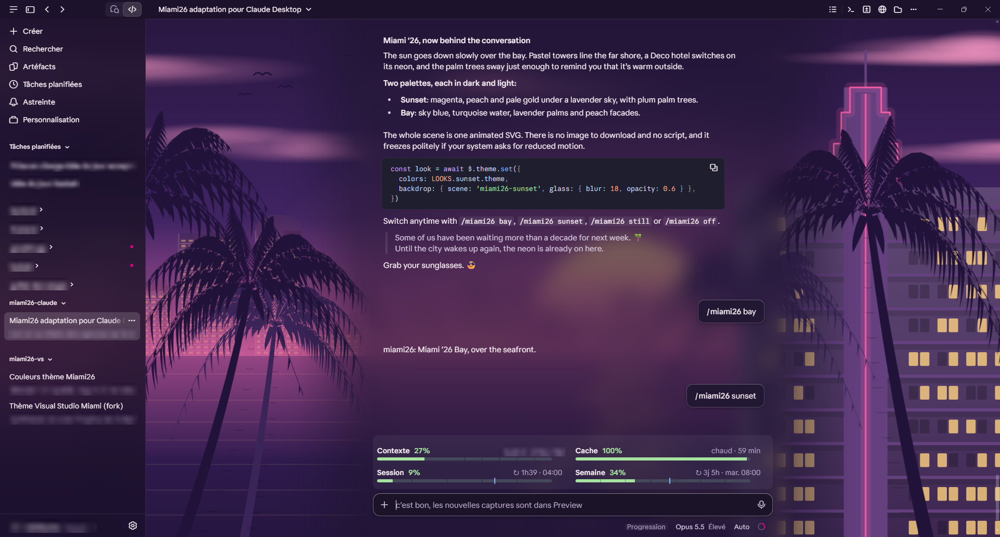
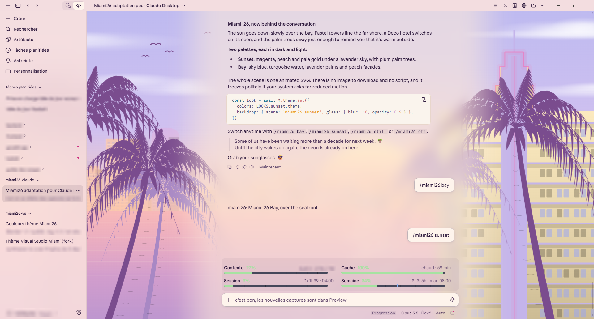
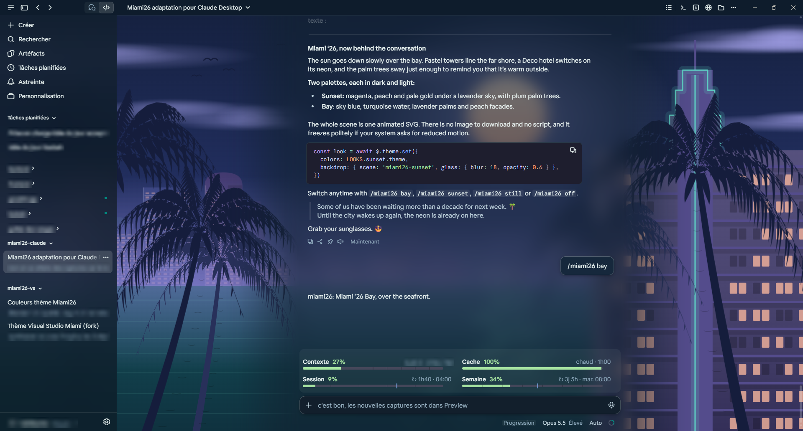
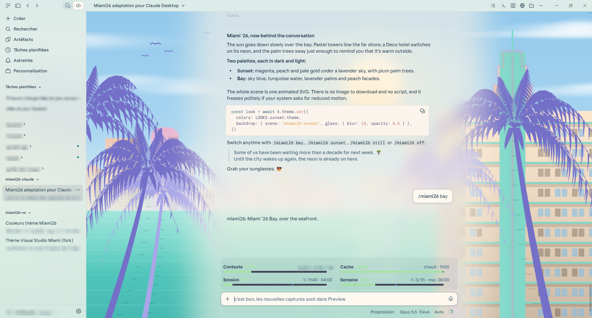

# Miami '26 - Claude Desktop theme

Miami colors for the Claude desktop app, as a mod. Two palettes, each in a dark and a light version, over an animated Miami seafront behind the conversation:

* **Bay**: a day on the bay. Sky blue, turquoise water, lavender palm trees, peach facades and warm sand.
* **Sunset**: dusk on the ocean front. Magenta, peach and pale gold under a periwinkle and lavender sky, with plum palm trees.

The backdrop is one animated SVG: pastel condo towers across the bay, the sun and its path on the water, a Deco hotel with a neon trim, birds and clouds drifting, and palm trees swaying. It follows the app's light or dark mode and stops moving when the system asks for reduced motion.

| | Dark | Light |
| --- | --- | --- |
| Bay | **Miami '26 Bay**, the bay at nightfall | **Miami '26 Bay Light**, the bay in daylight |
| Sunset | **Miami '26 Sunset**, dusk with neon | **Miami '26 Sunset Light**, the sky at dusk |

Also available for [VS Code](https://github.com/stillgbx/miami26-vscode) and [Visual Studio](https://github.com/stillgbx/miami26-vs).

### Miami '26 Sunset



### Miami '26 Sunset Light



### Miami '26 Bay



### Miami '26 Bay Light



## Install

In Claude Code:

```
/plugin install miami26 --marketplace stillgbx/miami26-claude
```

The look shows in the desktop and mobile apps. The terminal and the editors don't draw themes.

## Use

```
/miami26 sunset     the Sunset palette (default)
/miami26 bay        the Bay palette
/miami26 scene      the animated seafront behind the conversation (default)
/miami26 still      the colors alone, over a plain gradient
/miami26 off        back to the app's own look, for this session
```

Words combine (`/miami26 bay still`), and the choice is kept for the next sessions.

## Files

* `hooks/palettes.ts`: the two palettes, the app colors and the scene colors of each mode.
* `hooks/scene.ts`: the seafront, drawn as one SVG.
* `hooks/register.tsx`: sets the theme when a session starts, draws the backdrop and answers `/miami26`.
* `hooks/make-colors.js`: the design system's helper that turns a few colors into a whole theme. Don't edit it.
